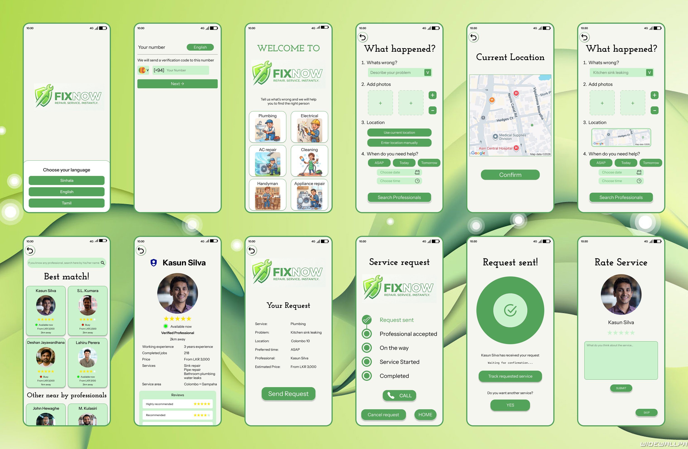
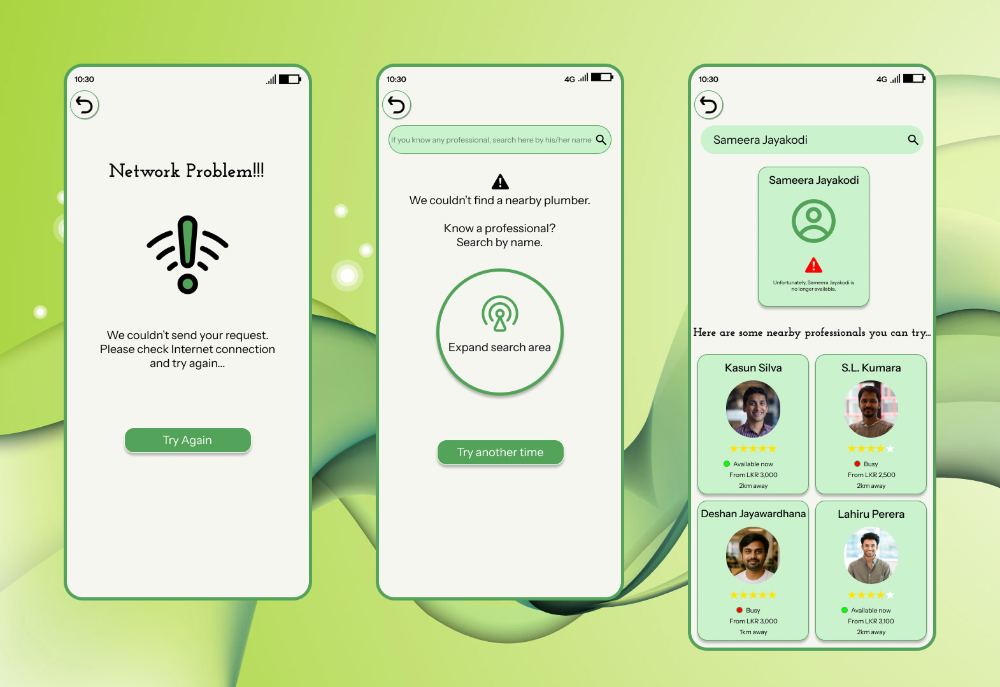
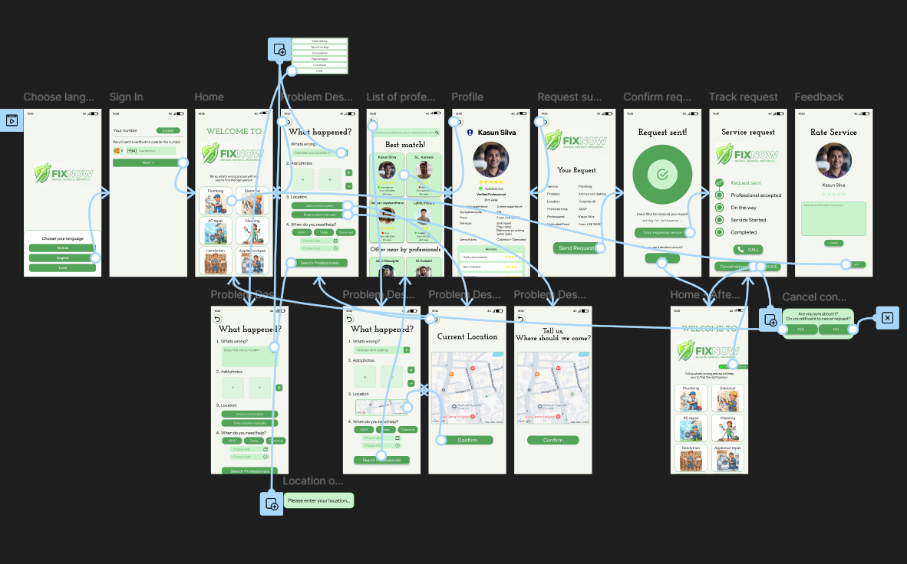

# FixNow — Find the Right Person for the Job! 🌿

**FixNow** is a mobile service marketplace UI/UX design project that helps users find, compare, and connect with suitable local service professionals for their everyday needs.

The goal of this project is to create a simple, accessible, and user-friendly experience that makes finding the right professional easier, more convenient, and more reassuring.

---

## 🎨 UI Design

## 📌 Project Overview

FixNow allows users to request local services, explore nearby professionals, compare available options, and track service requests through an intuitive mobile experience.

The design focuses on usability, accessibility, trust, and a smooth end-to-end user journey.

### 🎯 Project Goals

- Simplify the process of finding local service professionals.
- Provide a clear and intuitive service-request experience.
- Help users compare professionals before making a decision.
- Improve user confidence through professional profiles and verification indicators.
- Handle unexpected situations with clear guidance and alternative options.
- Create a connected, interactive prototype of the complete system.

---

## ✨ Key Features

### 🌐 1. Multilingual Experience
Users can choose their preferred language:
- Sinhala
- English
- Tamil

### 📱 2. Phone Number Sign-In
A straightforward sign-in flow that allows users to get started using their phone number.

### 🛠️ 3. Service Selection
Users can select the type of service they need, such as plumbing, electrical repairs, cleaning, air conditioning services, and other home maintenance services.

### 📝 4. Personalized Service Requests
Users can:
- Describe the problem they are experiencing.
- Upload photos to explain the issue.
- Confirm their current location or manually enter a different location.
- Select a preferred service date and time.
- Review their information before submitting the request.

### 👨‍🔧 5. Professional Discovery and Comparison
Users can explore suitable nearby professionals and compare their information to make informed decisions.

### 🛡️ 6. Verified Professional Indicators
Professional profiles include verification tags to help users identify professionals marked as verified and make more informed choices.

### 👤 7. Detailed Professional Profiles
Users can explore a professional's profile and available service information before deciding whether to send a request or return to the professional list to consider other options.

### ✅ 8. Request Summary and Tracking
Before submitting a request, users can review a summary of their selected service and request details.

After submission, users can track their request or initiate another service request.

### ⭐ 9. Ratings and Feedback
After the professional confirms that the service is completed, users can rate the service and share their feedback.

---

## ⚠️ Edge Cases and Error Handling

I designed three important edge cases to make the experience more robust and user-friendly.

### 1. Network Connectivity Issues
The interface provides feedback when a network issue interrupts the user experience, helping users understand that a connectivity problem has occurred.

### 2. No Nearby Professionals Available
When no professionals are available for the selected service nearby, users are encouraged to expand their search area or try again later.

### 3. Selected Professional Is Unavailable
When a user searches for a professional by name but that professional is no longer available, the interface recommends alternative nearby professionals.

These scenarios help demonstrate how the design addresses situations beyond the ideal user journey.

---

## 🔄 Complete Interactive Prototype

I created a fully interactive Figma prototype covering the complete system, connecting the screens and interactions to demonstrate the end-to-end user journey.

### Prototype Highlights
- Connected screens and navigation flows.
- Interactive service selection and request journey.
- Professional discovery and profile exploration.
- Request review and tracking flow.
- Ratings and feedback flow.
- Alternative scenarios and edge-case handling.

### 🔗 View the Figma Prototype

**[Click here to explore the interactive FixNow prototype](https://www.figma.com/design/1tefH7Q9rqiHLPIHKHiq6K/Untitled?node-id=1-4&t=j7sjOiOw3Yjqvxuq-1)**

---

## 🧰 Tools Used

- **Figma** — UI design, screen layouts, and interactive prototyping.
- **Figma Maps Plugin** — Location selection experience, allowing users to use their current location or manually enter a service location.
- **AI Tools** — Assistance with generating logo concepts.

---

## 💡 Key UX/UI Design Considerations

Throughout this project, I focused on:

- **User-Centered Design:** Making the service-request process clear and straightforward.
- **Usability:** Helping users navigate between service selection, professional discovery, and request submission.
- **Trust and Transparency:** Using professional profiles and verification indicators to support informed decisions.
- **Error Handling:** Providing guidance and alternatives when expected actions cannot be completed.
- **Interaction Design:** Connecting screens into a fully interactive prototype.
- **End-to-End User Flows:** Considering the experience from the initial sign-in through post-service feedback.

---

## 📚 Key Learnings

This project helped me strengthen my understanding of user flows, UI design, interactive prototyping, and designing for real-world scenarios.

It also reinforced the importance of considering edge cases, communicating system status clearly, and helping users make informed decisions throughout a digital experience.

---

## 👩‍💻 Project Information

**Project:** FixNow — Find the Right Person for the Job!

**Category:** Mobile App UI/UX Design

**Focus Areas:** User Experience Design, User Interface Design, Interaction Design, Prototyping, and Error Handling

**Design Tool:** Figma

---

*Designed with a focus on making everyday service discovery simpler and more user-friendly. 💚*
